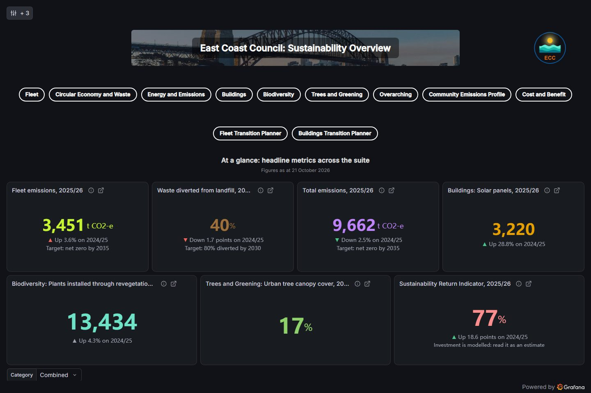
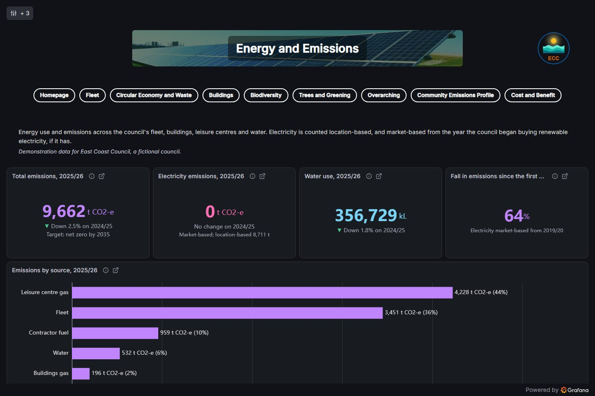
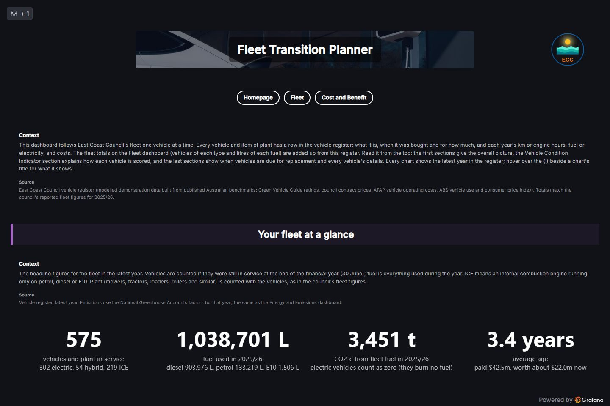
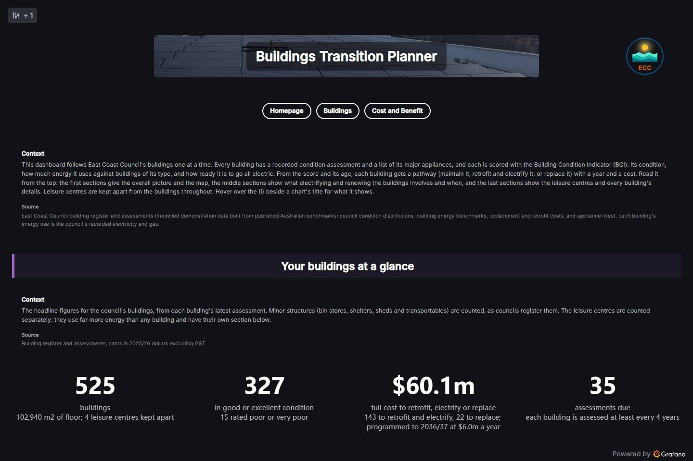
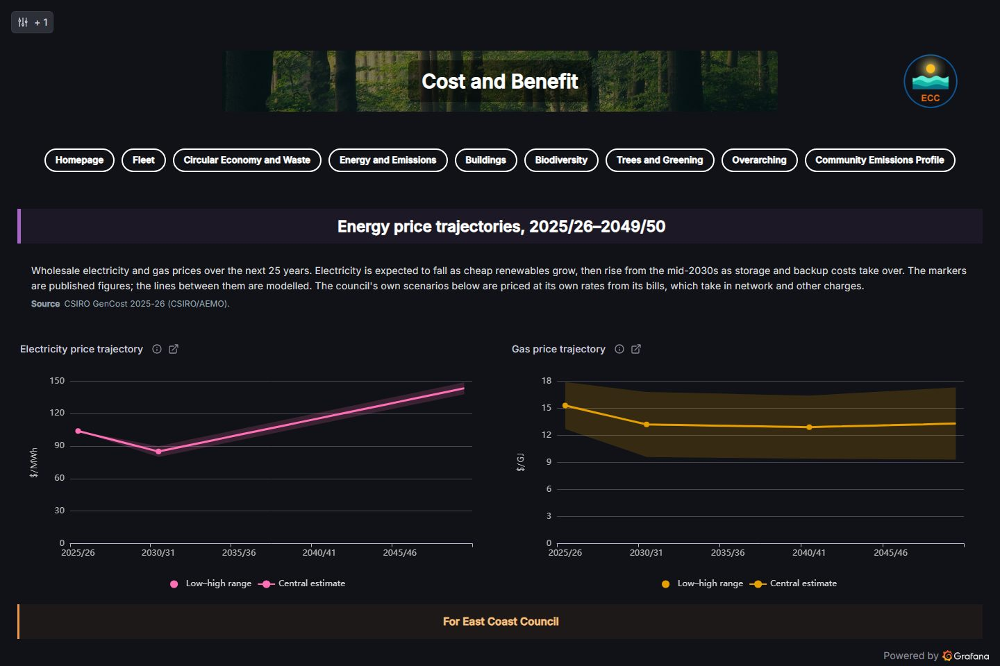
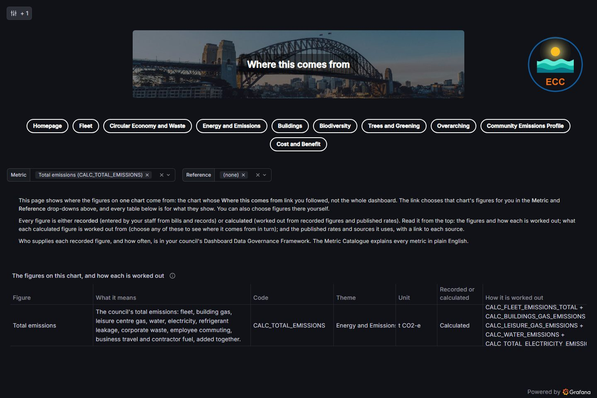
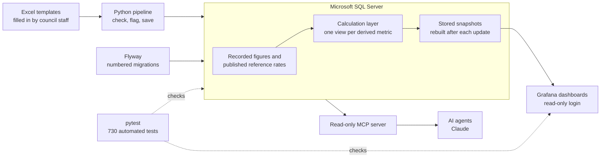

# Council Planning Platform

A sustainability data model, calculation engine and dashboard suite for local councils (municipalities). It helps them report emissions and plan the move to electric fleets and buildings. I design, build and maintain it as a commercial product.

> **About this repository.** This is a public showcase. The platform's source code is private and commercial, so this repository holds screenshots, the architecture, design decisions and a few sample files. Every figure shown belongs to **East Coast Council, a fictional demonstration council** built from published Australian benchmarks. None of it is a real council's data.

## What it does

- **Brings scattered figures into one model.** Utility bills, fuel records, tree counts and survey results go into one Microsoft SQL Server database, alongside published reference rates such as emissions factors.
- **Works out every derived figure the same way every time.** A calculation layer turns inputs and rates into emissions, intensities and indicators, so correcting one input corrects everything that depends on it.
- **Shows the results in ten linked dashboards.** Themed to each council's branding, with a "Where this comes from" page behind every chart.
- **Compares 25-year options.** The Fleet and Buildings Transition Planners compare going electric with like-for-like replacement, in both cost and emissions.
- **Lets a council's own staff run the annual update.** A guided Excel template and a check-then-save pipeline mean no ongoing support contract is needed.

## Screenshots

| | |
|---|---|
|  **Homepage.** Headline figures across the suite. |  **Energy and Emissions.** Emissions by source, location-based and market-based. |
|  **Fleet Transition Planner.** Every vehicle scored and timed for replacement. |  **Buildings Transition Planner.** Electrification options for each building. |
|  **Cost and Benefit.** The business case behind each initiative. |  **Where this comes from.** How each figure is worked out, and from what. |

All screenshots show demonstration data for East Coast Council, a fictional council.

## How it works

1. **Fill in.** Staff fill in an Excel template from their bills and records.
2. **Check.** A Python script loads the template into a holding area and checks every row. A copy comes back with a sheet listing anything to fix.
3. **Save.** Valid rows are saved to the database. Flagged rows wait for a person to approve them.
4. **Calculate.** The calculation layer works out every derived figure, and stored snapshots are rebuilt so dashboards open quickly.
5. **Show.** Grafana shows the new year, with every chart linked to where its figures come from.

## Built with

| Layer | Tools |
|---|---|
| Database | Microsoft SQL Server 2022 or later, T-SQL, Flyway migrations |
| Pipeline and tooling | Python, pyodbc, openpyxl |
| Dashboards | Grafana 13, Business Charts panel with Apache ECharts, JavaScript |
| AI | Model Context Protocol (MCP) server, Anthropic API, in-browser semantic search |
| Testing | pytest, headless browser checks, Node.js scripts |
| Video creation and editing | Descript, Claude, Playwright, ffmpeg, Vosk, Pillow, NumPy, cloudflared |
| Source control | Git and GitHub |

The full list, with versions, is in [STACK.md](STACK.md).

## Quality and testing

- **730 automated tests** (as at 25 October 2026) cover the schema's rules, calculations against hand-checked values, the annual pipeline, dashboards and installer.
- **They run at the right moments.** The affected tests run after every change, and the full suite runs before every database migration, annual data load and client handover. Each run is recorded with its reason and evidence.
- **Testing never changes live figures.** Every database test runs inside its own transaction and rolls back at the end. See [the fixture](samples/tests/conftest_excerpt.py).
- **Every figure is traceable.** A test fails if any chart's figure can't be traced back to its inputs and published sources. See [test_trace.py](samples/tests/test_trace.py).
- **Fast, measured dashboards.** Moving dashboards onto stored snapshots cut the slowest dashboard's cold load from 45.5 seconds to under 1.2 seconds. See [decision 0007](docs/decisions/0007-dashboards-read-stored-snapshots.md).

## Design decisions

Key choices are written up as architecture decision records:

- [0004: Flyway for database migrations](docs/decisions/0004-flyway-for-migrations.md). Every schema change is a numbered, repeatable script.
- [0005: Derived metrics as live SQL views](docs/decisions/0005-derived-metrics-as-views.md). No batch job that can silently go stale.
- [0007: Dashboards read stored snapshots](docs/decisions/0007-dashboards-read-stored-snapshots.md). Fast dashboards without giving up live calculations.

## How I build it

The platform is built with AI-assisted development, under clear rules:

- **Claude Code agents with narrow roles.** One agent builds; a separate agent runs static analysis and can only report what it finds.
- **Written rules and guardrails.** Each agent works from a rules file, and a shared lock means only one database job runs at a time.
- **A read-only MCP server.** AI agents can look up metrics, formulas and sources in the database, but can never change them.
- **A person signs off.** Fixes reach a release only after the tests pass and I've approved them.
- **Every change is a Git commit,** so the history of each build is clear and reversible.

## Status

Edition 2 (October 2026): the base reporting platform with ten dashboards, plus the Fleet and Buildings Transition Planners. Packaged as a self-contained install for each council, and being prepared for its first councils in New South Wales and Victoria.

## About

Built by **Reece Venema**, a data and AI consultant in Helsinki.
[reecevenema.com.au](https://reecevenema.com.au) · [LinkedIn](https://www.linkedin.com/in/reece-venema)

## Licence

Copyright © 2026 Reece Venema. All rights reserved. The screenshots, documents and sample code here are shared for viewing only. See [NOTICE.md](NOTICE.md).
